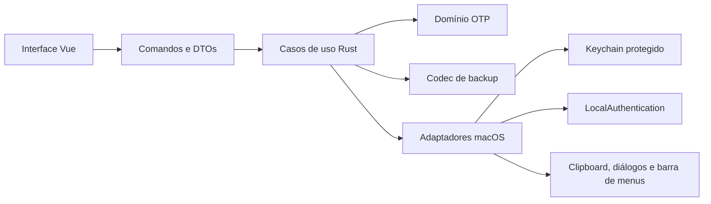

## Context

O repositório contém a licença MIT, documentação inicial e a estrutura OpenSpec. Não existe código de aplicação nem ferramentas de build configuradas. A motivação está em [proposal.md](proposal.md); os contratos de comportamento estão nas quatro capacidades de [specs/](specs/).

O usuário quer os fluxos comuns do Authenticator Extension dentro de um app de barra de menus, inclusive importação de backup pela interface, com liberação por senha ou digital. Nesta mudança, senha de desbloqueio significa a senha do usuário do macOS apresentada pelo sistema; a senha de backup pertence apenas à operação de importação/exportação.

A referência auditada é o commit `9d9660bb73700b3e725800edc22836662d94afac` do upstream. [docs/upstream-compatibility.md](../../../docs/upstream-compatibility.md) registra os formatos e as dependências observadas. A extensão usa Vue 2 e APIs de navegador; a nova aplicação precisa de apresentação modernizada e fronteira de segurança nativa.

## Goals / Non-Goals

**Goals:**

- Separar apresentação, regras OTP, autorização e integração macOS de modo que o domínio seja testável sem webview ou Keychain real.
- Autorizar leituras do Keychain por uma sessão nativa autenticada, mantendo consultas rápidas sem conta Apple ou perfil de provisionamento.
- Preservar parâmetros e resultados OTP no transporte de dados compatíveis; concentrar leitura, descriptografia e gravação de backup no backend.
- Fornecer um projeto reproduzível para humanos e agentes, com verificações que distingam simulação de integração real.

**Non-Goals:**

- Não portar Vuex/Webpack/browser storage nem o background script integralmente.
- Não criar mecanismo próprio de senha mestre, criptografia do cofre ou sincronização; o armazenamento persistente será Keychain local.
- Não introduzir API pública de exportação de seed, acesso genérico a filesystem/clipboard ou fallback automático de armazenamento.
- Não medir nem prometer tamanho final de binário antes do build, nem obter credenciais de assinatura ou publicar distribuição nesta etapa.

## Decisions

### 1. Tauri 2, Vue 3 e ferramentas locais reproduzíveis

Usar Tauri 2 com Rust para ciclo de vida e operações sensíveis; Vue 3 Composition API, TypeScript estrito e Vite para a interface. Vue preserva familiaridade com a organização visual do upstream sem acoplar o novo core aos modelos de extensão. CSS local com variáveis de tema é suficiente para o painel; adicionar biblioteca de UI/estado somente se houver necessidade concreta.

Alternativas consideradas: Electron adicionaria um runtime Chromium ao utilitário; AppKit/SwiftUI integral exigiria reescrever toda a apresentação fora da stack web solicitada. React/Svelte são viáveis, mas não oferecem vantagem suficiente aqui para mudar a família de componentes do upstream. Não haverá Node sidecar nem SSR.

Configurar Node 24 LTS/npm e registrar versões exatas do runtime e Rust stable no bootstrap; criar `package-lock.json`, `Cargo.lock`, `.nvmrc`, `rust-toolchain.toml` e `engines`. O Node 22.11 observado no ambiente não atende ao mínimo 22.12 informado pelo [Vite atual](https://vite.dev/guide/); verificar as versões disponíveis e seus requisitos no momento da implementação. Configurar o target do frontend para o WebKit disponível no macOS mínimo, sem depender do target padrão do Vite.

Scripts planejados: `dev`, `tauri:dev`, `build`, `tauri:build`, `typecheck`, `lint`, `format:check`, `test`, `test:e2e`. Ferramentas: `vue-tsc`, ESLint/Prettier, Vitest/Vue Test Utils, `cargo fmt`, Clippy e testes Rust. OpenSpec já está inicializado; não reinstalar suas configurações globais.

### 2. Camadas pequenas com dependências dirigidas ao domínio

```text
src/
  app/                         # composição, tema e estados globais transitórios
  features/accounts/           # lista, busca, fixação e edição
  features/vault/              # bloqueio, desbloqueio e estado de sessão
  features/transfer/           # importação/exportação pela interface
  lib/ipc/                     # DTOs e cliente de comandos
  components/                  # controles compartilhados
src-tauri/
  src/domain/                  # contas, parâmetros e algoritmos OTP
  src/application/             # casos de uso, sessão e interfaces de adaptadores
  src/platform/macos/          # Keychain, LocalAuthentication, clipboard e ciclo de vida
  src/compatibility/           # URI e codec de backup da extensão
  src/commands/                # entrada IPC, validação e tradução de erros
  capabilities/ permissions/   # permissões explícitas
tests/fixtures/                # dados sintéticos e sua proveniência
docs/                          # desenvolvimento, arquitetura e verificação nativa
```



Definir interfaces pequenas para armazenamento, autenticação, relógio, clipboard e seleção/gravação de arquivo. Tauri e APIs Apple ficam nos adaptadores, não no domínio. Evitar monorepo, framework de injeção ou crate separado para cada pasta nesta primeira entrega. RustCrypto (`hmac`, `sha1`, `sha2`, `argon2` e codecs necessários) fornece as primitivas; não implementar HMAC/AES/Argon2 do zero. `serde`, `thiserror`, `zeroize` e wrappers de segredo complementam contratos e tratamento de memória.

### 3. Shell de barra de menus controlado pelo Rust

Criar o ícone via `TrayIconBuilder`, com `tray-icon`, menu nativo Abrir/Bloquear/Sair e painel inicialmente oculto. Usar `ActivationPolicy::Accessory` para uma aplicação sem ícone no Dock. Clique principal alterna o painel; clique secundário apresenta o menu. Interceptar fechamento para ocultar; Sair executa bloqueio e encerra explicitamente. Uma instância única coordena todos os escritores do cofre.

Calcular posição a partir do retângulo do ícone e área de trabalho do monitor, convertendo coordenadas/DPI e limitando o painel às bordas. Usar janela opaca compacta sem depender de transparência ou API privada. Evitar um plugin de painel específico antes de comprovar necessidade com APIs públicas. Referências: [tray do Tauri](https://v2.tauri.app/learn/system-tray/) e [ActivationPolicy](https://docs.rs/tauri-runtime/latest/x86_64-apple-darwin/tauri_runtime/enum.ActivationPolicy.html).

Ocultar em Escape/perda de foco. Durante um diálogo nativo de autenticação ou transferência, tratar a mudança de foco como parte da operação; ao fechar/cancelar o fluxo, retomar a regra normal de ocultação. A UI terá estados explícitos: bloqueado, autenticando, vazio, lista, cadastro/edição, importação, exportação e erro recuperável.

### 4. Keychain por credencial, com valores sensíveis protegidos

Cada item de credencial contém um registro versionado com UUID, seed, emissor, conta, parâmetros OTP e próximo contador HOTP em `kSecValueData`. Os atributos consultáveis identificam apenas serviço e UUID; nomes de contas não entram nos atributos. LocalAuthentication pode autorizar um cofre vazio sem criar um item de controle. Nenhuma chave de criptografia de cofre é mantida em arquivo.

Implementar a integração com Security/LocalAuthentication por bindings Rust `objc2` e módulos correspondentes, isolando FFI/`unsafe` no adaptador macOS. Os bindings são candidatos a validar e fixar no bootstrap, conforme [objc2-local-authentication](https://docs.rs/objc2-local-authentication/latest/objc2_local_authentication/) e [objc2-security](https://docs.rs/objc2-security/latest/objc2_security/). Uma ponte Swift adicional só será considerada se os bindings não cobrirem as chamadas públicas necessárias, registrando a decisão.

Usar explicitamente o Keychain tradicional (`login`) via SecItem, com `kSecUseDataProtectionKeychain: false`, sem sincronização. A ACL padrão para operações sensíveis confia somente no aplicativo criador; nunca criar lista de aplicativos confiáveis que libere acesso geral. Validar assinatura ad hoc, atualização do binário e negativa de acesso por outro processo. A escrita/leitura deve funcionar sem conta Apple ou perfil. Referência: [Apple TN3137](https://developer.apple.com/documentation/technotes/tn3137-on-mac-keychains).

Os probes ad hoc Swift/Rust do modelo inicial retornaram `errSecMissingEntitlement (-34018)`. O usuário escolheu evitar conta Apple, então o data protection Keychain e `SecAccessControl.userPresence` deixam de ser pré-requisitos. A alternativa mantém proteção em repouso e ACL do Keychain; a autenticação biométrica controla a sessão do app, sem proteção biométrica independente do item. Não usar o plugin biométrico móvel do Tauri no desktop.

Persistir fora do Keychain apenas preferências visuais e um manifesto versionado de referências opacas, ordem e fixação. Esse arquivo não contém seed, nome, parâmetros sensíveis nem contador autoritativo. Criar/editar usando item novo seguido de substituição atômica do manifesto; registrar intenções de recuperação somente com IDs. Exclusão remove o item e atualiza referências, reportando qualquer falha. Recuperação detecta itens pendentes/referências ausentes sem apagar contas previamente confirmadas.

Dados sensíveis são lidos transitoriamente no Rust e descartados após uso, sem cache permanente de seeds. Aplicar zeroização aos buffers sob controle da aplicação e limitar cópias; bindings/frameworks e strings JS transitórias têm limites de garantia de apagamento, que devem ser documentados. O primeiro cadastro pode enviar seed/URI pela IPC; isso não autoriza ler de volta o seed existente.

### 5. Autenticação nativa de sessão e revogação

Um `LAContext` novo avalia `deviceOwnerAuthentication` no core Rust, com diálogo do macOS, Touch ID e fallback à senha do usuário. Somente o callback nativo bem-sucedido pode produzir a autorização privada da sessão; o frontend não recebe contexto nem pode fornecer resultado de autenticação. Após sucesso, os casos de uso podem ler itens do Keychain tradicional. Cancelamento/erro não executam nenhuma leitura de credencial. A [política Apple](https://developer.apple.com/documentation/localauthentication/lapolicy/deviceownerauthentication) também pode oferecer Apple Watch quando o sistema o disponibiliza.

Manter `Locked`, `Unlocking` e `Unlocked` no backend, com geração de sessão (`epoch`), início, última interação explícita e autorização nativa. Limites fixos iniciais: 120 s sem interação, 300 s de duração total e 15 s contínuos com painel oculto. Polling/timers de códigos não estendem a sessão. Eventos de bloqueio do macOS, suspensão, troca/inativação de sessão e encerramento revogam autorização; o retorno da suspensão permanece bloqueado. Validar observadores e comportamento real no protótipo nativo, sem tratar teste de timer como prova de bloqueio do sistema.

Bloquear incrementa `epoch`, invalida `LAContext`, cancela prévias/tarefas, limpa códigos nativos e solicita limpeza imediata da UI. Toda operação captura sua geração e verifica novamente sua validade antes de liberar resultado/efeito. Um sucesso atrasado de Touch ID não pode restaurar uma geração antiga. O frontend também descarta respostas com geração antiga, inclusive após voltar a mostrar o painel; a decisão final continua no backend.

Commits de mutações e bloqueio são serializados por um coordenador nativo. Trabalho caro e prompts acontecem fora da região de commit; validação de autorização e ponto de commit ficam ordenados. Uma gravação já efetivada antes do bloqueio permanece válida, mas seu código não será liberado depois da revogação. Não depender apenas de eventos enviados ao renderer para proteger operações.

Exportação exige contexto/autenticação novos, sem reusar automaticamente a autorização anterior, e valida novamente a sessão antes da gravação final. A senha de backup é fornecida pelo usuário nessa operação e nunca vira senha de desbloqueio do cofre.

### 6. OTP, relógio e consumo HOTP

Implementar TOTP com hora Unix e período da conta, HMAC e truncamento dinâmico conforme [RFC 6238](https://www.rfc-editor.org/rfc/rfc6238). HOTP SHA-1 segue [RFC 4226](https://www.rfc-editor.org/rfc/rfc4226); SHA-256/SHA-512 são variantes de interoperabilidade da extensão, não variantes normativas daquele RFC. Codificar resultados como strings para preservar zeros à esquerda. Validar integralmente parâmetros antes de armazenar.

O relógio de domínio é injetável. A hora civil calcula TOTP; os prazos de sessão usam um relógio apropriado a tempo decorrido, com invalidação explícita em suspensão/retomada. Recalcular janelas após ajustes do relógio; não copiar sincronização de horário via Google do upstream. A UI recebe código, validade e timestamp do backend, atualiza a contagem regressiva e solicita atualização nas fronteiras. Parar trabalho de apresentação com painel oculto; não recalcular seeds no JavaScript.

HOTP utiliza um escritor serializado. Com contador `c`, calcular o código, atualizar no Keychain para `c + 1`, verificar novamente a sessão e só então retornar/exibir. Falha de gravação não libera código. Encerramento depois da persistência pode pular um valor; o valor não é revertido. O último HOTP emitido fica apenas na memória da sessão para cópias repetidas. Uma tela redesenhada não gera HOTP.

Usar inteiros no Rust e strings decimais em DTOs de contador; validar o limite de interoperabilidade 9007199254740991 antes de converter para números JSON da extensão. Não emitir quando o próximo incremento ultrapassaria o limite. Alterações de contador somente avançam. Cadastro/edição se torna visível depois do commit; edição sem substituição explícita do seed preserva-o no native core.

### 7. IPC e superfície de permissões

Centralizar DTOs e um cliente tipado em `src/lib/ipc/`. Manter contratos Rust/TypeScript sincronizados por geração de schemas/tipos ou verificação de contrato automatizada, sem misturar DTO sensível com DTO de apresentação.

| Família de comandos planejada | Entrada/resultado permitido |
| --- | --- |
| `vault_status`, `unlock_vault`, `lock_vault` | Estado, motivo de bloqueio e geração; nunca contexto nativo. |
| `list_accounts`, `get_totp_codes` | Metadados autorizados e códigos/validade da sessão. |
| `save_account`, `preview_uri_account`, `delete_account` | Seed novo opcional somente na entrada; resultados sem seed. |
| `generate_hotp`, `copy_code`, `set_account_order` | IDs e geração; código emitido ou status, com autorização nativa. |
| `begin_import`, `provide_import_passwords`, `commit_import`, `cancel_import` | Seleção por diálogo nativo; senha transitória; ID de prévia e resumo sem seed. |
| `export_accounts` | IDs, formato, senha e reconhecimento de texto claro; diálogo nativo e resultado de gravação. |

Usar erros estáveis como `Locked`, `Cancelled`, `InvalidInput`, `UnsupportedFormat`, `StorageUnavailable` e `CounterExhausted`; detalhes de logs não incluem payload, senha ou seed. Importações recebem um identificador opaco associado à geração de sessão e expiram/cancelam com ela.

Restringir a capability à janela local do painel, comandos necessários e origens empacotadas. Definir allowlist explícita para comandos do app, não só plugins: [Tauri documenta](https://v2.tauri.app/security/capabilities/) que comandos registrados pelo aplicativo são permitidos por padrão, e aponta `AppManifest::commands` para alterar isso. Revisar o manifest gerado e provar negação em janela/origem sem autorização.

Não expor plugins genéricos de shell, HTTP, filesystem ou clipboard ao renderer. Aplicar CSP de produção restritiva sem conteúdo remoto, `eval` ou scripts inline arbitrários; liberar somente origem dev/HMR em configuração de desenvolvimento. Renderizar rótulos como texto, desligar DevTools em produção e excluir plugins/mocks de automação do release.

### 8. Backup dentro do app, com compatibilidade encapsulada

O painel terá ações Importar backup e Exportar backup. Na importação: abrir diálogo nativo, ler arquivo limitado no Rust, reconhecer formato, solicitar senhas para chaves necessárias, validar/descriptografar, apresentar prévia sem seeds e confirmar seleção. Na exportação: selecionar contas/formato, confirmar senha quando criptografado, autenticar novamente, escolher destino e receber status. Nenhuma dessas etapas exige terminal do usuário.

O codec suporta JSON não criptografado (`OTPStorage`) e v3 (`EncOTPStorage` + `Key`). Preservar campos suportados, defaults, ordens e pinning; parâmetros fora do escopo geram resultado visível. Para múltiplos `keyId`, guardar senhas somente durante a prévia e permitir fornecê-las separadamente. Não reinterpretar `OldKey` nem `encrypted: true` como seed em texto claro.

Descriptografar v3 no Rust, reproduzindo a representação exata da derivação Argon2id e do envelope CryptoJS a partir das fixtures de referência. O hash bruto Argon2 codificado em Base64 sem padding é a senha textual do envelope; usar diretamente bytes de chave produziria um formato diferente. Limites: arquivo 5 MiB, 1000 contas, 32 chaves, texto de conta/seed 1024 bytes, ciphertext de registro 16 KiB; PHC com Argon2id v19, no máximo 64 MiB de memória, 6 iterações, paralelismo 4 e saída de 32 bytes. Validar limites antes de derivar; processar chaves sequencialmente em tarefa cancelável, com progresso e orçamento de execução de 30 s por tentativa. A derivação principal v3 usa os parâmetros fixos observados de 19456 KiB, 2 iterações e paralelismo 1; limites também se aplicam ao verificador de senha recebido.

Na prévia, detectar duplicatas por identidade/configuração/seed normalizados apenas em memória nativa e por proveniência quando disponível. Manter existente por padrão; não diminuir HOTP. Revisão informa todos os motivos de não importação. Seleção explícita de subconjunto é permitida. Para commit, gravar itens novos em staging, manter um journal de IDs, substituir o manifesto de referências atomicamente e limpar itens órfãos após sucesso/recuperação. Nenhum item anterior é alterado antes do commit do novo conjunto; falha não resulta em lista parcialmente importada.

Exportação padrão usa v3 e senha confirmada, com salts/IDs aleatórios e envelope compatível, sem persistir a senha. Criar fixture de ida e volta verificável pela extensão. Esse envelope serve somente à interoperabilidade de backup: seu esquema baseado em CryptoJS não oferece a propriedade de integridade autenticada de AES-GCM. Não descrevê-lo como um novo cofre ou formato autenticado; validar conteúdos após decriptação e documentar essa limitação. Um formato nativo de backup com AEAD será uma mudança separada, se necessário.

O backend grava backup criptografado com permissão restrita em arquivo temporário cifrado e commit atômico no destino confirmado. Texto claro exige seleção e reconhecimento explícitos; escrever apenas no destino final novo com permissão restrita, sem temporário em texto claro e sem sobrescrever um arquivo existente. Remover saídas incompletas em falhas tratadas e registrar recuperação sem seeds. O renderer recebe status, nunca JSON/Blob/URI de download. Exportar não consome HOTP nem altera contas.

### 9. Clipboard e transientes de UI

O backend calcula TOTP no momento de copiar e obtém HOTP do último resultado emitido na sessão. Escrever via adaptador `NSPasteboard`, registrando a identidade da escrita/`changeCount`; limpar após 30 s, bloqueio ou encerramento somente se essa identidade continuar atual. Comparar só o texto seria incorreto caso outro app escrevesse o mesmo valor.

Remover códigos e metadados da UI ao bloquear/ocultar, limpar campos de seed/URI/senhas após envio ou cancelamento e descartar resultados de gerações antigas. Não usar persistência automática de formulários, stores ou query caches com campos sensíveis. Não copiar seeds em fluxos comuns; a área de transferência do sistema continua sujeita à observação de outros apps, mesmo com prazo de limpeza.

### 10. Validação e entrega macOS

Testar por risco: vetores oficiais OTP e bordas temporais; parâmetros/URIs e fixtures upstream; falhas no Keychain, commits incompletos, concorrência HOTP e bloqueio durante operações; estados de UI e labels hostis. Não adicionar testes que apenas espelhem wrappers sem verificar comportamento.

Um protótipo `.app` nativo comprova persistência no Keychain tradicional e ACL, autenticação LocalAuthentication, cancelamento, sessões limitadas e invalidação antes da integração completa. Testes automatizados usam namespaces exclusivos e contas sintéticas; verificam ausência de leitura de credencial antes de autenticação. CI cobre domínio, contratos e build; não declarar Touch ID testado em runners sem sensor.

Para desktop, usar WebdriverIO com serviço Tauri e provider embedded em um build exclusivo de testes, de acordo com a [documentação atual](https://v2.tauri.app/develop/tests/webdriver/) e [WebdriverIO](https://webdriver.io/docs/desktop-testing/tauri). Asserções de UI automatizadas não substituem autenticação nativa real. Plugins/servidor de automação e APIs de mock serão compilados somente na configuração de teste; verificar ausência no bundle final.

Registrar smoke tests reais: iniciar bloqueado, abrir/fechar/reabrir, teclado/VoiceOver, dois monitores, Touch ID/senha/cancelar, sistema bloqueado/suspenso, falha de armazenamento, importação/exportação pelo app e restart HOTP. Preparar builds locais arm64/x86_64 com mínimo macOS 13; suporte publicado exige evidência no target correspondente. Configurar build/entitlements/assinatura com identidade estável; não alegar notarização sem executá-la.

## Risks / Trade-offs

- [Keychain tradicional tem APIs/ACLs legadas e não impõe biometria ao item] → Encapsular o adaptador, restringir confiança ao aplicativo e exigir autorização nativa em todos os casos de uso. Um processo nativo comprometido está fora do modelo de proteção; não apresentar esta alternativa como equivalente ao controle biométrico do data protection Keychain.
- [Atualização de assinatura ad hoc pode alterar a confiança da ACL] → Fixar identificador, testar acesso após atualização e documentar a confirmação nativa do Keychain quando necessária, sem ampliar acesso geral.
- [Webview comprometido pode usar operações disponíveis durante uma sessão válida] → Restringir comandos/origens, CSP e duração da sessão; nunca fornecer seed em leitura comum e exigir nova autenticação para exportar. O modelo não protege contra comprometimento completo do processo ou do macOS.
- [Envelope criptografado upstream não autentica integridade] → Confiná-lo à interoperabilidade, validar schema/valores, não usar seu esquema para armazenamento local e registrar limites de segurança do backup compatível.
- [Muitos itens de Keychain e reuso de contexto podem afetar UX/performance] → Medir com dados sintéticos, agrupar leitura quando necessário e pausar atualização com painel oculto; otimizações não enfraquecem presença do usuário.
- [Bloqueio do sistema ou conclusão assíncrona pode chegar em momento inesperado] → Coordenador de commit, gerações de sessão e smoke tests reais de bloqueio/suspensão; nenhuma resposta antiga restabelece autorização.
- [Crash pode consumir um HOTP sem exibi-lo] → Preservar incremento e explicar no guia de recuperação; reverter contador criaria reutilização.
- [Backup em texto claro e clipboard expõem informação fora do cofre] → Exigir exportação explícita/nova autenticação, limitar arquivos escolhidos e limpar clipboard condicionalmente. A escolha de texto claro fica visível ao usuário.

## Migration Plan

1. Criar manifests, ferramentas e camadas sem importar dados reais. Validar a integração nativa protegida antes de ligar operações do cofre à UI.
2. Implementar shell/sessão/domínio, persistência e contratos; integrar contas e transferências dentro do app com fixtures sintéticas.
3. Validar recuperação e interoperabilidade nos dois sentidos; a extensão original e os arquivos escolhidos para importação permanecem inalterados.
4. Preparar `.app`/`.dmg` com assinatura ad hoc, sem perfil Apple, e documentar Gatekeeper/confiança de ACL após atualização. Developer ID/notarização são opções futuras de distribuição, sem pré-requisito para esta implementação.
5. Para rollback de código, manter itens do Keychain e manifesto; versões de schema desconhecidas falham sem destruição. Desinstalar não apaga seeds automaticamente. Uma futura migração incompatível deve criar novos registros e manter os anteriores até o commit confirmado.

## Open Questions

- Qual nome/ícone final será usado no bundle? `TopOTP` é o nome atual e um ícone template provisório basta para validar o tray. Assets finais não alteram os contratos desta mudança.
