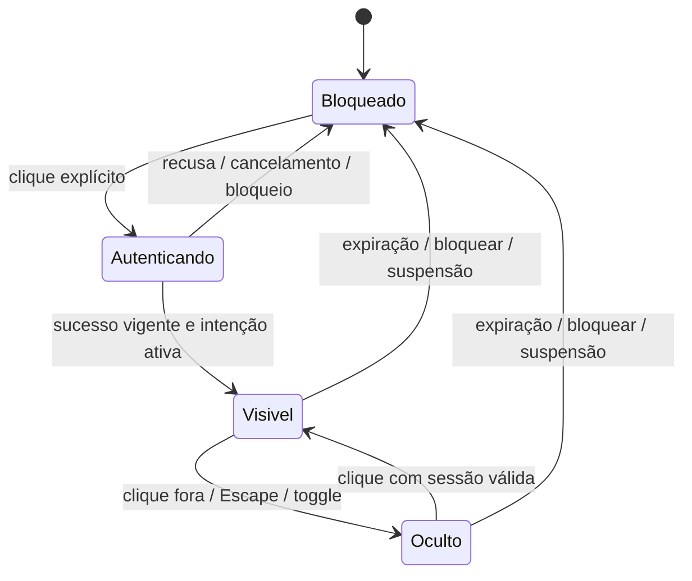

## Context

Ver [proposal.md](proposal.md) para motivação e escopo. A base é a beta `v0.0.1-beta.1`, commit `530bf1c`, com geração, sessão, persistência e backups no core Rust. `src-tauri/src/lib.rs` coordena um tray e uma única janela `panel`; `App.vue` concentra lista e formulários. A validação IPC e a inspeção de release pressupõem essa janela única.

`application/core.rs` já oferece listagem, TOTP, geração HOTP, cópia e autorização por geração de sessão. `platform/macos/auth.rs` contém o ator estável de LocalAuthentication, e `keychain.rs` usa o Keychain tradicional. O usuário confirmou a beta, após uma regressão anterior de foco/autenticação ter exigido rollback. Esta mudança deve reutilizar esses adaptadores e exercitar a nova coordenação separadamente.

A mudança original permanece aberta para verificações manuais; não arquivá-la nem transformar essas pendências em evidência desta interface. Não existem specs principais em `openspec/specs/`: os três contratos desta mudança descrevem as novas superfícies. Ao sincronizar/arquivar futuramente, reconciliar o shell anterior com o acesso nativo; os contratos de cofre, OTP e compatibilidade continuam válidos.

## Goals / Non-Goals

**Goals:**

- Isolar apresentação AppKit e coordenação testável de interação, mantendo decisões de autorização no Rust.
- Evitar que notificações de foco, timers ou cancelamentos iniciem autenticação; abrir o painel somente após autorização quando o clique ocorreu bloqueado.
- Reutilizar formulários e fluxos de transferência na janela de gerenciamento, com fronteiras IPC explícitas.
- Ler QR de uma região escolhida sem introduzir arquivos de captura ou retorno de segredos à apresentação.
- Manter macOS 13+, operação offline, identidade do app e compatibilidade dos dados; estabelecer identidade de assinatura persistente para atualizações locais.

**Non-Goals:**

- Reescrever o aplicativo inteiro em SwiftUI ou trocar a política de LocalAuthentication. Um helper restrito de armazenamento foi acrescentado após comprovar a restrição de partição do Keychain login.
- Expor captura genérica, shell, filesystem ou clipboard à janela web.
- Acrescentar controles de configuração sem comportamento implementado, mudar limites de sessão, publicar nova versão ou substituir a instalação estável durante o desenvolvimento.

## Decisions

### 1. Painel AppKit e menu secundário nativo

Manter Tauri como ciclo de vida e host da janela de gerenciamento. Obter o `NSStatusItem` existente por `with_inner_tray_icon`, como já faz o posicionamento atual. Criar um `NSPopover` com `NSViewController`, lista rolável de linhas nativas, `NSSearchField` no topo e botão Mais no rodapé. O botão abre um `NSMenu` ancorado, com os comandos definidos na spec. Usar materiais semânticos, cores e fontes do sistema, respeitando contraste e transparência reduzida; o resultado acompanha a versão do macOS.

AppKit fica em `platform/macos/quick_access/`, com objetos retidos somente na thread principal. O domínio não conhece views. Dados para preencher a lista são metadados e códigos autorizados, obtidos fora da thread principal; alterações de views voltam à thread principal com validação da geração e da intenção de apresentação.

O coordenador trata o menu Mais como parte da interação atual. Não aplicar o handler global `Focused(false)` da janela web ao popover nem fechar a árvore por abertura do submenu. Escape, clique externo real e toggle pelo ícone encerram a interação. Validar esse comportamento primeiro com dados sintéticos, inclusive foco da busca e navegação até Mais.

Alternativas: `NSMenu` para a lista inteira reduz customização, mas views embutidas têm limitações documentadas de teclado e de atualização durante tracking; uma busca editável e uma lista com validade se encaixam melhor em um popover. Um painel web com novo CSS não entrega controles nativos. SwiftUI via ponte adicionaria outra camada de build/FFI sem necessidade inicial, pois `objc2-app-kit` já está disponível.

Referências: [NSPopover](https://developer.apple.com/documentation/appkit/nspopover), [NSSearchField](https://developer.apple.com/documentation/appkit/nssearchfield?language=objc), [views em menus](https://developer.apple.com/library/archive/documentation/Cocoa/Conceptual/MenuList/Articles/ViewsInMenuItems.html), [materiais AppKit](https://developer.apple.com/documentation/AppKit/NSVisualEffectView/Material-swift.enum).

### 2. Coordenador de ativação sem nova política de autenticação

Extrair a sequência de desbloqueio hoje iniciada por `commands::unlock_vault` para um caso de uso compartilhado, preservando `begin_unlock`, `NativeApproval`, o guard de diálogo, `finish_unlock` e tratamento de falha. Não modificar `auth.rs`, parâmetros de `LAContext` nem ACL dos itens existentes para resolver comportamento de UI. A continuidade de assinatura e a migração deliberada para um serviço novo estão descritas na decisão 9.

O coordenador mantém intenção de abertura e identificador de tentativa, separados da geração de sessão. Somente uma ativação explícita pode transitar de bloqueado para autenticando. Cliques repetidos durante a mesma tentativa não a reiniciam. Com sessão válida, o clique apresenta ou oculta o painel sem autenticar.

Quando bloqueado, não abrir o popover antes do prompt. Após sucesso, concluir o desbloqueio e apresentar a lista apenas se a tentativa e a intenção ainda forem atuais. Isso evita usar perda/recuperação de foco para reabrir ou autenticar. Cancelamento encerra a intenção; callbacks atrasados, polling e eventos de alteração do cofre nunca a recriam. Expirar com painel aberto limpa/fecha a apresentação e aguarda nova ação, sem outro prompt.

O core continua iniciando bloqueado, com limites de 120 segundos sem interação, 300 segundos totais e 30 segundos sem superfície visível. Bloqueio manual, suspensão, inativação da sessão macOS e encerramento revogam autorizações. Resultados de workers capturam geração de sessão e intenção de apresentação; validar ambas antes de mostrar, e a sessão novamente no caso de uso antes de revelar resultado ou efetivar efeito.

### 3. Visibilidade e eventos compartilhados

Substituir a suposição de uma única janela visível por um registro de superfícies no coordenador: painel rápido, janela de gerenciamento e transições explícitas. Comunicar ao core visibilidade agregada, contando janelas efetivamente visíveis e não minimizadas. Transferir visibilidade para a janela antes de concluir o fechamento do popover; não reiniciar o prazo oculto em notificações repetidas. Diálogos de transferência/autenticação seguem o guard existente e não constituem interações que renovam timers.

Separar o prazo de retomada do painel do prazo de sessão: mesmo que a janela permaneça visível, busca/rolagem/seleção do painel expiram após 30 segundos daquele painel oculto. Não persistir esses dados. Parar atualização de códigos ao ocultar, remover códigos das views e revalidar antes de repovoá-las.

Centralizar a publicação de alterações de estado no Rust para alcançar painel nativo e janela, incluindo bloqueio por menu, comando, tick e notificações do sistema. Eventos web carregam somente estado/metadados autorizados e não autorizam operações. Cada superfície descarta respostas de gerações anteriores; a checagem decisiva permanece no core. O ciclo atual de invalidação/clipboard continua sendo usado.

### 4. Lista, busca, cópia e HOTP

Preservar ordem/fixação do manifesto e apresentar emissor, conta, código e segundos restantes como texto. Cada linha identifica a conta por UUID; callbacks não transportam seed. Buscar por emissor/conta com comparação Unicode sem distinção de caso/diacríticos. Desabilitar autosave/recentes de `NSSearchField`. Teclado: foco inicial na busca, Command-F para retornar a ela, setas para resultados, Return para acionar TOTP e Tab para controles/Mais; Escape oculta o painel.

Atualizações de TOTP usam o relógio do core; um timer visual não lê seeds nem renova a sessão. Cópia chama `Core::copy`, que recalcula TOTP atual. HOTP continua com Gerar próximo e cópia separada do último código emitido; filtrar/renderizar nunca chama `Core::hotp`. O incremento precisa persistir antes da entrega. Falha de persistência não revela código; bloqueio após commit pode consumir um contador sem entrega, mas não o reverte. A limpeza do clipboard mantém a comparação da identidade de escrita existente.

O painel expõe rótulos acessíveis sem anunciar o código a cada tick. Seleção, confirmação de cópia, erro de armazenamento, cofre vazio e busca vazia têm estados legíveis. Metadados hostis são strings, sem HTML.

### 5. Janela de gerenciamento e contratos restritos

Criar uma única janela Tauri de label `management`, inicialmente não criada/oculta, com decorações e redimensionamento. Reaproveitar `AccountForm`, `ImportForm`, `ExportForm` e a gestão de contas em uma composição própria. Configurações abre a seção Geral com versão e regras atuais de sessão, além de navegação para contas e transferências; não acrescentar controles de login automático ou mudança de política nesta mudança.

O coordenador guarda uma rota tipada permitida (`general`, `accounts`, `new-account`, `import`, `export`, `qr-review`) até a UI informar que está pronta. Uma ação nativa pode criar/focar a janela e selecionar a rota sem perder o evento no carregamento. Repetições reutilizam a janela. Fechar não encerra o app; perda de foco não a oculta. Minimizar/ocultar limpa campos secretos; fechar/bloquear descarta formulários e prévias pendentes.

Atualizar `client()` e capabilities para a origem local e label `management`; remover a permissão do painel web substituído em produção. A integração AppKit chama casos de uso Rust, sem abrir IPC genérico. Novos comandos expõem somente rotas e operações específicas necessárias; revisar também a inspeção de release, que hoje exige `windows: ["panel"]`. Manter CSP, bloqueio de navegação remota e DevTools desativadas.

Imports claros/v3, múltiplas senhas, duplicatas, enums numéricos e exportação permanecem no codec/casos de uso atuais, conforme [compatibilidade upstream](../../../docs/upstream-compatibility.md). Exportação mantém autenticação nova e destino nativo, com revalidação antes da gravação e recuperação existente. Não atualizar o snapshot upstream nem reescrever a criptografia nesta mudança.

### 6. Seleção de região, captura e Vision

Criar adaptadores específicos em `platform/macos/scan/` e um caso de uso de cadastro por QR. Somente Escanear QR da tela inicia a operação autorizada. Um overlay AppKit por monitor permite arrastar uma região e cancelar por Escape; não é uma janela web com poder de captura. Converter pontos da seleção para o display e pixels correspondentes, tratar origens negativas e escalas Retina, e remover overlays/painel antes do frame final. A seleção fica restrita a um monitor por captura; tentar cruzar monitores limita a seleção ao monitor de início.

Usar ScreenCaptureKit: `SCScreenshotManager.captureImage(contentFilter:configuration:)` no macOS 14+; no macOS 13, obter um frame completo de `SCStream` e parar imediatamente, com `sourceRect`/dimensões limitadas à região. Não usar incondicionalmente métodos de captura por retângulo introduzidos no macOS 15.2. Solicitar acesso pelo fluxo nativo de permissão quando necessário, somente após a ação do scanner; recusa/restart necessário produzem orientação sem loop de prompts. Não capturar áudio, câmera ou conteúdo periodicamente.

Entregar a imagem diretamente a `VNDetectBarcodesRequest`, limitada à simbologia QR. Adicionar somente os bindings `objc2` necessários para ScreenCaptureKit/Vision e seus tipos auxiliares, verificando API/disponibilidade no SDK e fixando lockfile; não instalar uma stack de scanner de navegador. Imagem, buffers e payloads permanecem no backend; sem subprocesso `screencapture`, arquivos temporários, clipboard ou serviço remoto.

Limites iniciais: no máximo uma operação em andamento, 16 milhões de pixels no frame de saída, 16 QRs candidatos e 8 KiB por URI, alinhando o último ao parser existente. Regiões maiores são recusadas antes de alocar; não reduzir a resolução silenciosamente a ponto de mudar a capacidade de leitura. Trabalho de captura/decodificação acontece fora da thread principal com timeout de 15 segundos após a seleção. Liberar o stream e buffers em todas as saídas; zeroizar payloads/buffers mutáveis sob controle do app e documentar limites de cópias internas de frameworks.

Referências: [ScreenCaptureKit](https://developer.apple.com/documentation/ScreenCaptureKit?language=objc), [SCScreenshotManager](https://developer.apple.com/documentation/screencapturekit/scscreenshotmanager?language=objc), [VNDetectBarcodesRequest](https://developer.apple.com/documentation/vision/vndetectbarcodesrequest?language=objc). A disponibilidade 14.0/15.2 foi conferida também em `SCScreenshotManager.h` do SDK local durante a exploração.

### 7. Revisão sem URI secreta na janela

Validar cada payload com o parser `otpauth://` existente. Protocolos externos/Google migration, algoritmos e parâmetros não suportados geram classificação sem abrir links. Distinguir QR ausente, payload inválido, formato não suportado, permissão negada e limites excedidos. Se houver vários candidatos, a janela mostra escolha por metadados e mensagens para os candidatos rejeitados; somente um candidato escolhido pode ser confirmado por operação.

Criar uma prévia nativa identificada por UUID e geração de sessão, reaproveitando as regras de duplicata e commit do fluxo URI/importação. A janela recebe campos não secretos e IDs; nunca recebe imagem, URI ou seed reconhecido. Ao confirmar, persistir a conta escolhida pelo mecanismo de staging/manifesto existente. Duplicatas preservam o registro atual; HOTP não retrocede. Nenhuma gravação ocorre no reconhecimento ou na abertura da revisão.

Após esperas por permissão, seleção, captura e decodificação, revalidar a sessão. Durante a seleção, manter a transição de UI coerente, sem renovar os prazos de inatividade/absoluto. Bloqueio/expiração cancela a intenção, fecha overlays, interrompe captura e descarta prévias. Uma conclusão tardia não abre janela nem autentica novamente. O usuário pode repetir a ação após desbloquear explicitamente.

### 8. Validação por camada e distribuição isolada

Testar o coordenador com relógio/autenticação/controladores de apresentação sintéticos: uma tentativa por clique, cancelamento sem retry, sucesso atrasado, perda de foco pelo diálogo, submenu, handoff de visibilidade e limites exatos. Exercitar views AppKit em um executável de testes com contas sintéticas para montagem/ações/filtro; isso não comprova a interação real de foco/VoiceOver.

Migrar os testes Vue/E2E para a janela `management`, preservando a interoperabilidade clara/v3 e o contador HOTP. Testar QR com imagens geradas de dados sintéticos e falhas de permissão/captura simuladas, incluindo vários QRs, imagem sem QR, payload hostil e bloqueio durante decodificação/commit. Nenhum teste exige a conta ou a senha real do usuário.

O harness WKWebView não cobre automaticamente views AppKit. Registrar smoke tests do `.app` separado para clique bloqueado, Touch ID/senha/cancelamento, permanência após sucesso, Mais, busca/teclado, clique externo, 30 segundos, suspensão e configurações. Validar captura real, permissão negada e segundo monitor; separar evidência de macOS 13/Intel apenas compilados de execução real. Atualizar o inspetor para a nova capability e verificar que produção não inclui os adaptadores de teste/automação.

### 9. Identidade local e migração deliberada após a regressão

O candidato ad hoc instalado perdeu a confiança exigida pelos itens do estável. O teste real com dois binários diferentes e Keychain descartável reproduziu a recusa `-25293`; um certificado local com EKU codeSigning permitiu leituras/atualização entre versões, mantendo bloqueado outro identificador assinado pelo mesmo certificado. A correção não depende de abrir repetidamente diálogos de senha nem de alterar o ator de LocalAuthentication.

`scripts/local-signing-identity.py` cria uma identidade própria no Keychain padrão, com acesso à nova chave de assinatura restrito ao `codesign`. Chaves/contêineres transitórios são protegidos e removidos; passphrases não ficam em argumentos. Metadados públicos em `~/Library/Application Support/TopOTP Build/signing.json` fixam o fingerprint. Nunca regenerar silenciosamente a identidade se estiver ausente, expirada ou indisponível. Não instalar raiz confiável nem alterar trust settings. O wrapper local reutiliza essa identidade; CI ad hoc é identificado explicitamente e não comprova atualização segura.

No processo do app, desabilitar somente a UI do Keychain tradicional por `SecKeychainSetUserInteractionAllowed(false)`. LocalAuthentication permanece responsável pelo diálogo nativo. Tratar `-25293`/`-25308` como recusa de acesso distinta e revogar a sessão antes de outro tick/leitura. Não iniciar autenticação por polling.

O binário antigo ad hoc não compartilha identidade com o novo. O usuário escolheu exportar um backup criptografado no TopOTP estável com todas as contas e contadores atuais. A nova versão usa serviço `com.rafaelmariano.topotp.signed.vault.v1` e manifesto `vault-signed-v1`; debug e smoke têm namespaces separados. Detectar apenas a existência do manifesto anterior, sem tentar ler seus seeds. Quando há cofre antigo e nenhum manifesto novo, após autenticar abrir a rota `migration`, com seleção de arquivo, senha transitória e prévia/commit existentes. Cancelar/falhar mantém a orientação e não apaga o antigo. IDs internos de importação são novos; IDs de origem, ordem, favoritos, parâmetros e contadores continuam preservados pelo formato existente.

Exportar imediatamente antes da troca. Não gerar HOTP no app antigo após exportar; os cofres independentes não sincronizam incrementos. Não prometer rollback seguro de contadores depois de consumir HOTP na nova versão. Atualizações seguintes exigem requisitos designados compatíveis nos dois sentidos e prova sintética de acesso entre builds com a mesma identidade. A migração inicial é um caminho separado, não uma aprovação falsa do preflight antigo→novo.

`native-smoke` é uma feature exclusiva de debug e identifier próprio: usa os adaptadores reais de autenticação/Keychain com contas públicas sintéticas, sem abrir o cofre pessoal. Pode validar a composição completa antes da instalação. É proibida em release como E2E/probe AppKit.

## Risks / Trade-offs

### Complemento após diagnóstico de 16/10: dono estável do Keychain

O preflight de DR passou, mas todos os itens do cofre direto examinado por metadados têm `ACLAuthorizationPartitionID` com o CDHash `017bfbef…` do build anterior. O novo CDHash `217dc7dd…` não satisfaz essa condição, embora ambos tenham o mesmo certificado e identificador. O chaveiro estava desbloqueado e não havia journal. Nenhum valor de credencial foi solicitado. O teste anterior usava Keychain descartável explicitamente selecionado, insuficiente para representar o login padrão. Referência: [Apple DTS sobre condições independentes de ACL/partição](https://developer.apple.com/forums/thread/845980).

Manter um helper Swift pequeno, assinado uma vez por arquitetura e preservado em `TopOTP Build/vault-helper-v1`, com protocolo binário fixo de CRUD por UUID e limite de 32 KiB. O core Rust permanece responsável por sessões, biometria, OTP, journal e transferências. Somente o helper acessa o novo serviço do Keychain em produção. O transporte é um socketpair anônimo herdado: o helper valida audit token/certificado/identificador do pai, deriva o namespace desse identificador e revalida o código antes de cada operação. O pai valida o processo filho pelo CDHash compilado antes de enviar segredos. Sem endpoint nomeado, serviço arbitrário, retry ou fallback direto. EOF encerra o helper; falha de transporte revoga a sessão. Memória controlada é limpa, sem promessa de zeroização das cópias internas dos frameworks Apple.

O build fixa hash de fonte, identidade e CDHash; fonte/cache divergentes param sem regenerar outro dono. O empacotamento deve preservar o CDHash do helper e validá-lo depois da assinatura. Builds CI ad hoc não comprovam nem habilitam esse caminho de confiança local. A prova de upgrade deve usar o login real com serviço sintético isolado, além da comparação de requisitos. Dois builds da interface, rollback, outro namespace e pai não autorizado integram a prova.

A nova propriedade dos itens exige transferência deliberada para `vault-broker-v1`/serviço derivado do cliente. Restaurar primeiro o build `5a46add6…`, que satisfaz a partição dos itens diretos. Exportação/importação são feitas pelo usuário na UI; preservar todo o cofre anterior e seus contadores. Não ampliar ACL/partições nem introduzir senha do Keychain para contornar a recusa. O helper fixo evita repetir essa transferência nas atualizações normais da interface; atualizar o próprio helper é uma migração de segurança separada e nunca silenciosa.

### Complemento: remoção explícita e janela persistente

“Remover todos os dados” atua no cofre atual; a confirmação informa que backups externos e o namespace legado preservado não são removidos. A UI exige `REMOVER`; o core valida essa intenção, usa LocalAuthentication existente uma única vez e revalida a geração antes de qualquer exclusão. O commit publica manifesto vazio e mantém os UUIDs aposentados no journal até a exclusão efetiva no Keychain. Nesta operação a falha de limpeza é propagada, nunca convertida em sucesso. Iniciada a escrita, sucesso ou falha revogam a sessão e limpam prévias/HOTP/clipboard próprio. Recuperação durável ocorre somente numa próxima operação autenticada; polling não tenta excluir nem autenticar. Um manifesto vazio válido impede reativar a orientação de migração na reinicialização.

A janela `management` declara `hidesOnDeactivate = false` no AppKit. Perda de foco e Escape não solicitam fechamento. A lógica web de 30 segundos do painel anterior é retirada; o prazo de retomada continua exclusivo do popover AppKit. Minimização limpa campos secretos e códigos, com revalidação antes de reapresentar; os prazos do core continuam vigentes. Revogação limpa formulários sem fechar a janela e preserva apenas a seção Geral para retorno após desbloqueio explícito. O controle de fechar da janela continua ocultando e descartando rascunhos.

- [Nova coordenação de foco pode repetir a regressão anterior] → Abrir o popover após autenticar, iniciar tentativas somente por ação explícita, testar single-flight/cancelamento e não alterar os adaptadores estáveis para corrigir UI.
- [Submenu e busca nativa dependem da interação AppKit real] → Fazer o protótipo sintético antes da ligação ao cofre e registrar teste de teclado/foco/submenu em macOS; testes web não bastam.
- [Duas superfícies podem discordar sobre visibilidade ou estado] → Coordenador único, registro agregado de visibilidade, geração de sessão e um canal de alterações nativas.
- [Permissão de tela e APIs variam por versão do macOS] → Caminho de frame único para macOS 13, checagem de disponibilidade, tratamento de recusa e verificação real por target.
- [Captura contém material sensível] → Região explícita, limites antes de alocar, processamento local em memória, descarte em todas as saídas e nenhuma captura genérica acessível à janela web.
- [Dois conjuntos de controles aumentam a manutenção] → AppKit restrito ao acesso rápido; regras de segurança, OTP, transferência e revisão permanecem no core compartilhado.
- [Atualizar ad hoc perde confiança do Keychain] → Assinatura local persistente, preflight entre versões, migração única por backup e prova real com itens sintéticos. Não ampliar ACL dos itens antigos.

## Migration Plan

1. Criar primeiro o coordenador e o protótipo AppKit com contas sintéticas, sem iniciar operações no cofre pessoal. Validar busca, menu e eventos antes da ligação ao core.
2. Integrar o desbloqueio compartilhado, visibilidade e janela de gerenciamento; manter os contratos dos registros. Remover a criação do antigo painel web de produção quando o novo fluxo estiver integrado.
3. Integrar captura/QR/revisão e executar as suítes sintéticas e de interoperabilidade; registrar separadamente os smoke tests nativos reais.
4. Gerar `.app`/`.dmg` em diretório de artefatos separado, sem publicar release, alterar a tag beta existente ou substituir o `.app` estável. Inspecionar arm64/x86_64 e a ausência de automação em produção.
5. Criar/reutilizar a identidade local e validar leituras/atualização/negação ao identificador estrangeiro com o mesmo certificado e itens sintéticos. Testar o shell isolado com adaptadores nativos reais antes de usar contas pessoais.
6. Solicitar a exportação criptografada pela UI estável; após confirmar o backup, trocar o app e conduzir a importação na rota de migração. Preservar o bundle e todo o cofre antigo, sem reescrever ACL/manifesto.
7. Rollback anterior à importação usa a beta preservada. Depois de consumir HOTP na nova versão, voltar ao cofre antigo exigirá transferir o estado atual: seus contadores não acompanham a nova versão automaticamente. Nenhuma exclusão de dados faz parte da implantação.
